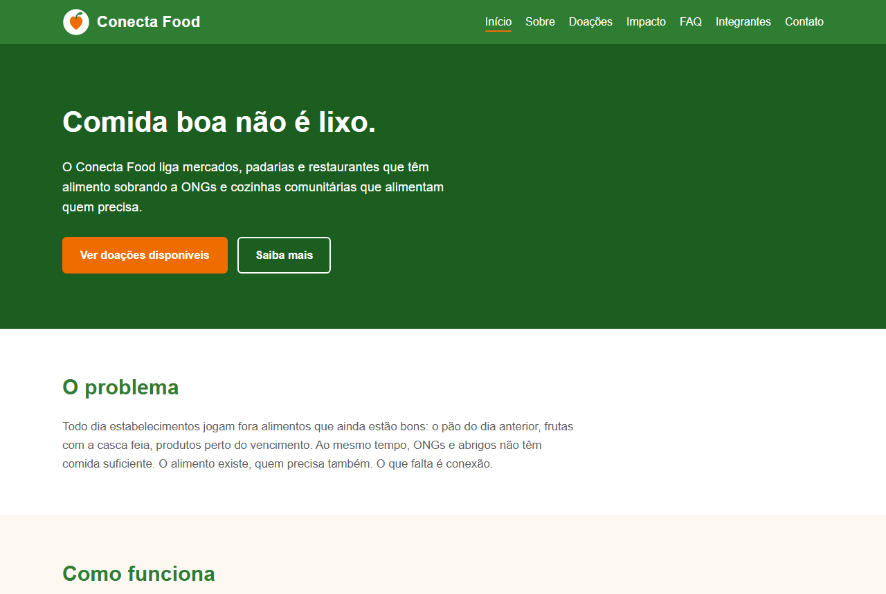
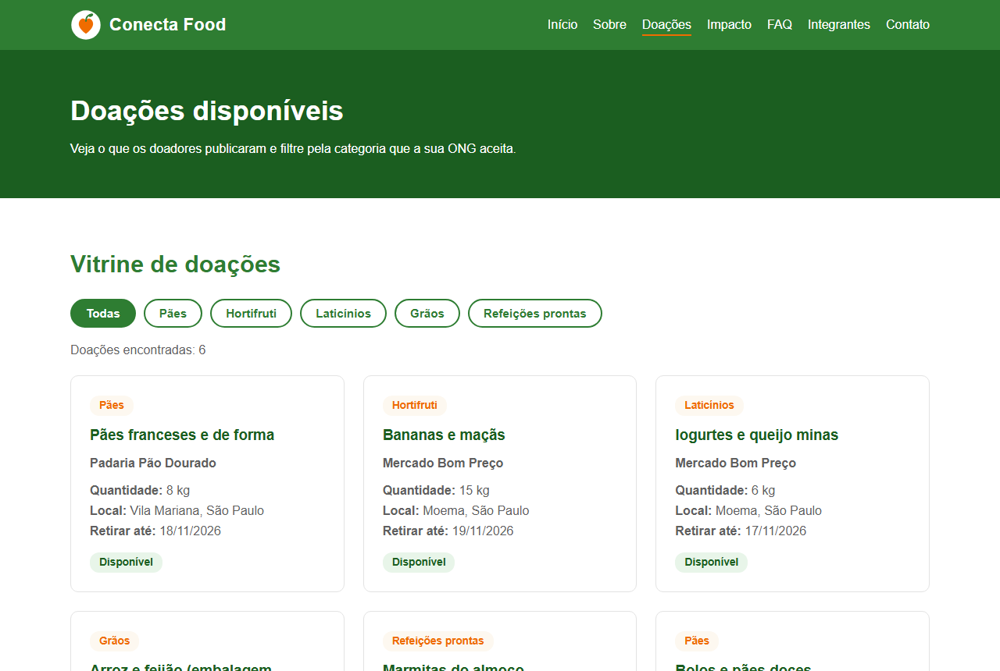
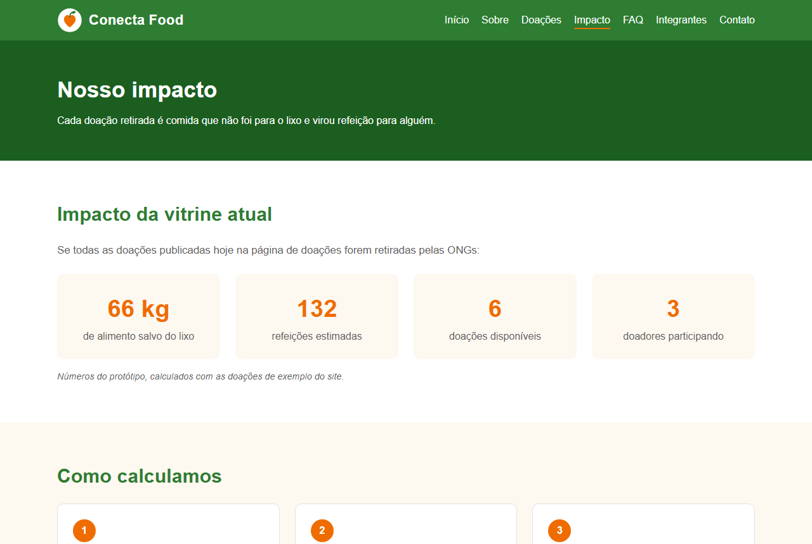
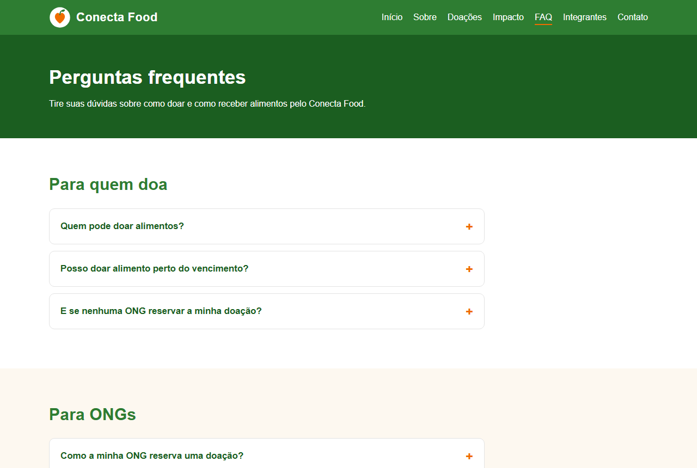
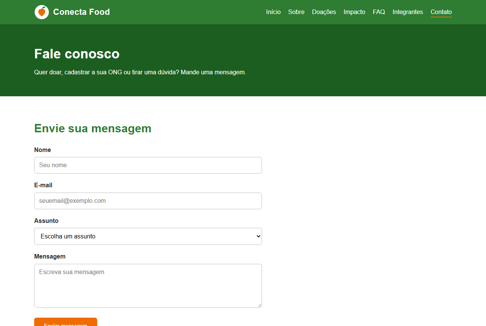
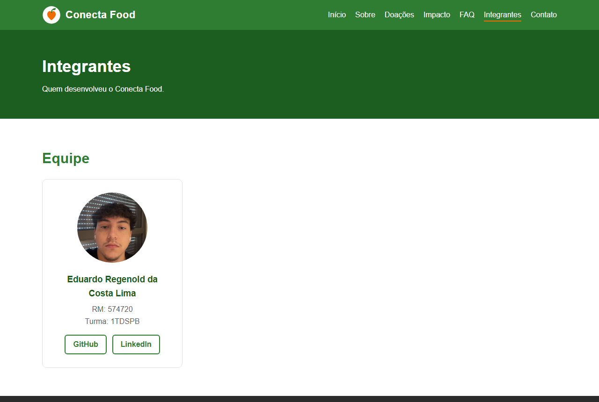
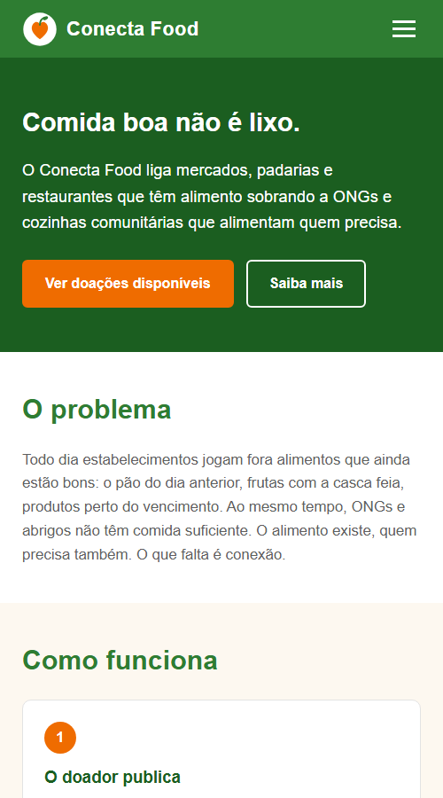

# Conecta Food

## Descricao
Todos os dias mercados, padarias e restaurantes descartam alimentos que ainda estao bons para consumo, enquanto ONGs e abrigos nao tem comida suficiente para quem atendem. O Conecta Food é uma plataforma que conecta quem tem alimento sobrando a quem precisa de verdade. O doador publica a doacao, o sistema sugere as ONGs mais proximas, a ONG reserva e busca o alimento.

Projeto desenvolvido para a Global Solution da FIAP (tema CitizenTech).

## Tecnologias utilizadas
- HTML5
- CSS3
- JavaScript
- Git e GitHub

## Estrutura de pastas
```
conecta-food/
├── index.html        -> pagina inicial
├── sobre.html        -> problema, objetivo, proposta e ODS
├── doacoes.html      -> vitrine de doacoes com filtro por categoria
├── impacto.html      -> quilos salvos e refeicoes estimadas
├── faq.html          -> perguntas frequentes (acordeao)
├── integrantes.html  -> quem desenvolveu o projeto
├── contato.html      -> formulario de contato com validacao
├── css/
│   └── style.css     -> estilos do site (cores, layout e responsividade)
├── js/
│   ├── menu.js       -> menu hamburguer do celular
│   ├── filtro.js     -> filtro da vitrine de doacoes
│   ├── faq.js        -> abre e fecha as respostas do FAQ
│   └── contato.js    -> validacao do formulario de contato
├── assets/
│   └── img/          -> logo, foto e imagens
│       └── prints/   -> prints das telas usados neste README
└── README.md
```

## Autor
| Nome | RM | Turma | GitHub | LinkedIn |
|---|---|---|---|---|
| Eduardo Regenold da Costa Lima | 574720 | 1TDSPB | [edurege-14](https://github.com/edurege-14) | [Eduardo Regenold](https://www.linkedin.com/in/eduardo-regenold-b09bab397/) |


## Imagens do projeto

### Pagina inicial


### Vitrine de doacoes com filtro por categoria


### Impacto (quilos salvos e refeicoes estimadas)


### Perguntas frequentes (acordeao)


### Contato com validacao do formulario


### Integrantes


### Versao para celular (menu hamburguer)


## Repositorio
https://github.com/edurege-14/conecta-food

## Contato
eduregenold@gmail.com

## Uso de IA
Ferramenta usada: Claude

Para que foi usada:
- ajuda com conceitos especificos. Como o filtro e acordeao;
- ajudar a revisar trechos de codigo e a encontrar erros;
- ajuda para fazer tabelas ou "formulario" como o do README;


